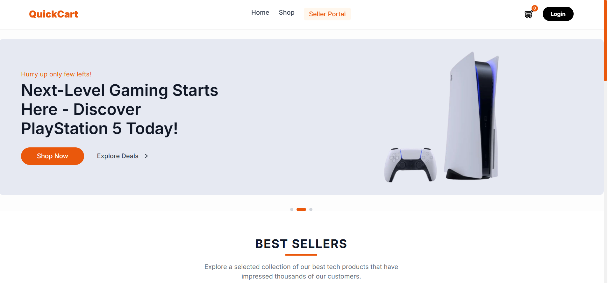
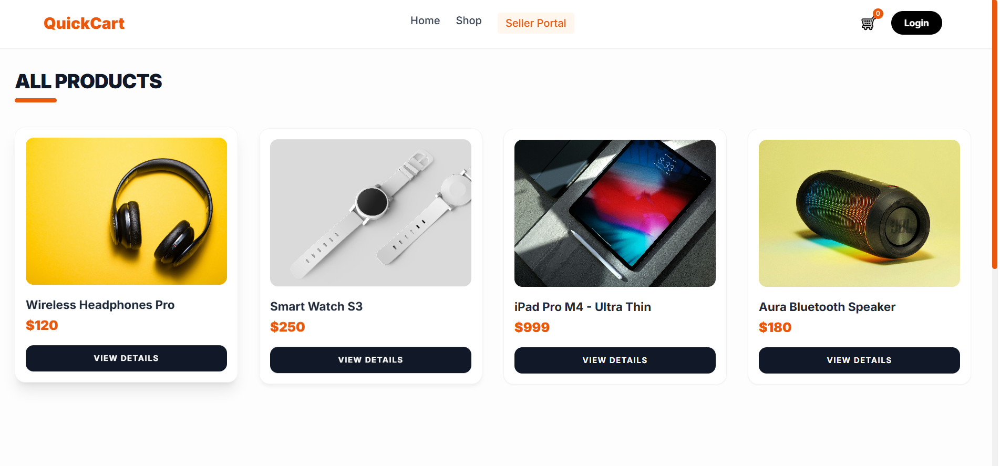
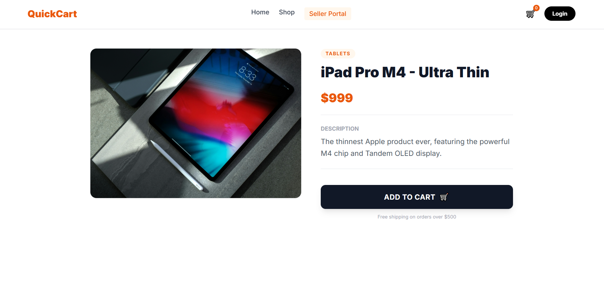

# QuickCart

A tech e-commerce storefront with a promotional slider, product catalog, product detail pages, shopping cart, and a seller portal.

Live demo: https://store-app-adnan.netlify.app

## Screenshots

## Features

- Animated promotional slider and best-sellers section
- Shop page listing all products
- Product detail pages
- Shopping cart managed with the Context API
- Login page and Seller Portal covering both buyer and seller journeys
- Fully responsive layout with a mobile navigation menu

## Tech Stack

- [Next.js](https://nextjs.org/)
- [Tailwind CSS](https://tailwindcss.com/)
- React Context API for cart state
- Deployed on [Netlify](https://www.netlify.com/)

## Getting Started

git clone https://github.com/Adnan-AlTellawy/e-commerce-store
cd quickcart-store
npm install
npm run dev
Then open http://localhost:3000 in your browser.

## Notes and Future Improvements

This project currently uses static product data and front-end only login and seller screens. Planned next steps:

- Connect to a backend API for real products and orders
- Add real authentication
- Persist the cart between sessions

## Author

Adnan Jahed Al-Tellawy — Front-End Developer
[GitHub](https://github.com/Adnan-AlTellawy) · [LinkedIn](https://www.linkedin.com/in/adnan-altellawy-497500448) · [Portfolio](https://adnan-altellawy.netlify.app) · adnanaltellawy@gmail.com